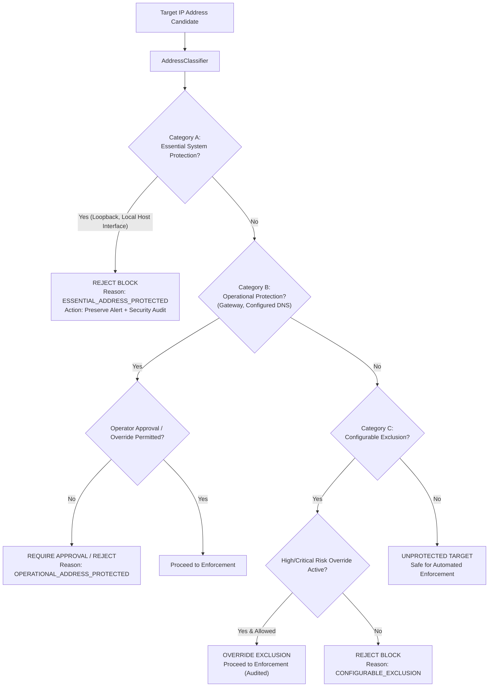

# Protected-Address Policy Engine & Classification Specification

## 1. Root Cause Analysis of Previous Limitations

During the audit of the legacy implementation, several structural flaws were identified:

1. **MAC Address Inclusion**: `psutil.net_if_addrs()` enumerates all network socket families, including `socket.AF_LINK` (or `psutil.AF_LINK`), which returns hardware MAC addresses (e.g., `a4:83:e7:...`). The legacy code inserted raw string addresses into the protected set without family filtering. When checked against IP address rules or `pfctl`, this led to type errors and confusing allowlist entries.
2. **Indiscriminate Hardcoding of Public Resolvers**: Public DNS resolvers (`8.8.8.8`, `1.1.1.1`, `9.9.9.9`) were universally exempted from firewall enforcement across all environments, regardless of whether the system actually used them as primary resolvers. Attackers routing attacks through or spoofing public IPs could exploit this blanket immunity.
3. **Detection Suppression (Silent Drops)**: In `detector.py`, checking `is_protected(src_ip)` resulted in immediate `return None`, discarding the detection altogether. This violated the core principle: **detection must always be recorded; protection policy only governs the blocking decision**.
4. **Binary Allow/Deny State**: The legacy allowlist provided no machine-readable reason codes or protection categories, returning merely a tuple of `(bool, str)`.

---

## 2. Three-Tier Protection Policy Architecture

To eliminate these vulnerabilities, A2IDS implements a structured, three-tier policy engine:

---

## 3. Detailed Category Specifications

### Category A — Essential System Protection
Prevents automatic blocking of addresses whose loss would sever host kernel communication, system loopback, or active management interfaces:
- **Loopback**: `127.0.0.1/8` and `::1/128`.
- **Active Local Host Interfaces**: Dynamically discovered IP addresses on all physical and virtual interfaces (Wi-Fi `en0`, Ethernet, VPN tunnels), strictly filtering for `socket.AF_INET` and `socket.AF_INET6` (excluding hardware MAC addresses).
- **Special Addresses**: `0.0.0.0/8`, `255.255.255.255/32`, Multicast (`224.0.0.0/4`, `ff00::/8`), Link-local IPv6 (`fe80::/10`).

> **Rule:** An Essential Protected address **CANNOT be automatically blocked under any circumstance**. The threat detection is preserved in full, and an audited `REJECTED_ESSENTIAL_PROTECTION` event is recorded.

### Category B — Operational Protection
Addresses essential to external network transit and resolution:
- **Default Gateway**: Discovered dynamically from the OS kernel routing table (`route -n get default`).
- **Configured Host DNS Resolvers**: Parsed from `/etc/resolv.conf` (only nameservers actively configured on the host).

> **Rule:** Threat detections against operational addresses are flagged. Automatic blocking is deferred or requires operator approval to prevent inadvertent denial of internet connectivity.

### Category C — Configurable Exclusions
Operator-defined exceptions and trusted endpoints:
- Subnets (e.g., corporate management subnets `192.168.1.0/24`).
- Temporary maintenance exceptions with explicit expiration timestamps.

> **Rule:** If a detected threat achieves **HIGH** or **CRITICAL** risk with verified evidence, the policy engine allows configurable exclusions to be overridden when explicitly authorized in system configuration (`allow_override_configurable=True`).

---

## 4. Machine-Readable Policy Decision Codes

Every evaluation generates an explicit, auditable result:

| Decision Code | Action | Meaning |
| :--- | :--- | :--- |
| `UNPROTECTED_TARGET` | Allow Block | Address is an external host; safe to block. |
| `ESSENTIAL_ADDRESS_PROTECTED` | Reject Block | Address is host loopback, local interface, or kernel endpoint. |
| `OPERATIONAL_ADDRESS_PROTECTED` | Require Approval / Reject | Address is default gateway or active DNS resolver. |
| `CONFIGURABLE_EXCLUSION_HONORED` | Reject Block | Target matched operator allowlist; override not enabled. |
| `CONFIGURABLE_EXCLUSION_OVERRIDDEN` | Allow Block | High/Critical threat verified; exclusion overridden. |
| `INVALID_ADDRESS_FORMAT` | Reject Block | Target string failed IP address parsing. |
